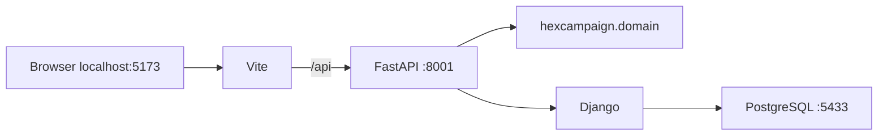

# Hex Campaign

A browser campaign map for tabletop miniature games. Players lock secret moves on a hex map. When every player has locked an order, the server resolves the turn. Battles are played with miniatures on a real table, and the result is then recorded. The first version is a table of 2 to 4 players.

How to change this repository is in [`AGENTS.md`](AGENTS.md). The game rules are in `docs/reglas-de-campana.md`. The backend contract is in `docs/requisitos-tecnicos-backend.md`.

The campaign rules are original. The project does not include official artwork or copied rule text.

## Stack

- Python for the campaign rules, with no web framework inside those rules
- Django for the database, users, and admin
- FastAPI as the only HTTP API the browser calls
- React and TypeScript for the interface
- PostgreSQL
- Redis for rate limits shared across API workers (optional locally)

## Status

PostgreSQL runs in Docker. Redis is available in the same compose file when more than one uvicorn worker must share login and write limits. Django migrations create the tables, including the campaign row that stores the living state.

Campaigns, the map studio, the freehand map editor, banners, and the terrain board are in the browser. Drawn maps may use an irregular subset of the chosen table size. With a terrain map, starting a campaign opens a preparation phase where each seat lays roads on home land before turn 1; a road click returns `kind: roads_delta`, and placing a fortress returns `kind: fort_delta`. The browser also locks secret orders, resolves the turn when every seat has locked, and lets an administrator judge a battle. The miniature fight itself stays on the table. What the screen still does not offer is listed at the end of `docs/reglas-de-campana.md`.

A person registers with email and a password of 12 to 128 characters, plus a unique alias of 3 to 24 letters, digits, or underscore. The date of birth must make them at least 16. Sex is one of woman, man, other, or undisclosed. If that email belongs to a confirmed account, ignoring case and surrounding spaces, the API responds with 422 and “Este correo ya está registrado.” and leaves the account unchanged. An unconfirmed signup can be replaced by a later registration for the same email: the previous link stops working and a new message is sent. Confirming the link requires the password from that signup. Staff, inactive, and admin-created accounts are left untouched. A taken alias is reported when it belongs to someone else. Birth date and sex are shown in the Django admin only.

A confirmed, active player signs in with `POST /api/session`. The response sets `__Host-session` (HttpOnly) and `__Host-csrf`. Logout sends that second value back in the `X-CSRF-Token` header. The database stores only an HMAC-SHA256 of each secret, keyed with `SESSION_PEPPER`, so a copy of the database is not a usable cookie. The cookie lasts at most 180 days and ends after 60 days without a visit. The campaign stays stored either way. One account may keep 10 sessions, and any of them can play every campaign. Logout closes only that browser. Changing the password or deactivating the account closes all of them. An unknown email, an unconfirmed email, and a wrong password all get the same 401. The `Origin` or `Referer` must be `API_ORIGIN`, and the map has to be served on that origin. This cookie is not the Django admin session.

## Architecture

The browser talks to one API. FastAPI owns that HTTP contract. Django owns persistence, accounts, and the admin. Registration and email confirmation are the routes under `/api`. Campaign rules belong in `hexcampaign.domain`, which does not import a web framework. One process serves both frameworks.



A game write sends the revision the browser last read. The API checks the player session, the origin and `X-CSRF-Token`, locks the campaign row and repeats that number. If another write landed first, the response is 409 and nothing is stored. The living match stays in the campaign JSON. Lists, the pulse and invitation previews read columns filled in the same save.

While the page is open, the browser also listens on `GET /api/events` for campaign and notification pushes. The same cycle, in order, is recruitment, placement or road preparation, secret orders, one simultaneous resolution, the tabletop battle, and the chronicle once the match is finished.

## Local start

Use Python 3.12 and Node 22. Copy `.env.example` to `.env` at the repository root. `API_ORIGIN` stays `http://localhost:5173`. Docker publishes PostgreSQL on host port **5433** (inside the container it still listens on 5432). The workflow on GitHub maps 5432 because that service is not this compose file. Mailpit accepts mail on port 1025 and shows it at http://localhost:8025. The confirmation link uses `API_ORIGIN`.

Two terminals. The first one stays on uvicorn.

Terminal 1, from the repository root:

```bash
docker compose up -d postgres mailpit
cd backend
py -3.12 -m venv .venv
.venv\Scripts\activate
python -m pip install -e ".[dev]"
python manage.py migrate
uvicorn config.asgi:application --reload --port 8001
```

In PowerShell, activate with `.\.venv\Scripts\Activate.ps1`. On macOS or Linux, create the environment with `python3.12 -m venv .venv` and activate it with `source .venv/bin/activate`.

`migrate` creates the tables on an empty database and applies later changes without deleting campaigns. The Docker volume keeps the data between restarts. Swagger is at http://127.0.0.1:8001/api/docs while `DEBUG` is on. It is absent when debug is off.

A single local process can leave `CACHE_URL` empty (LocMem). For several workers, start Redis (`docker compose up -d redis`) and set `CACHE_URL=redis://127.0.0.1:6379/1`. The `redis` package is already installed by `pip install -e ".[dev]"`. Production requires `CACHE_URL`. `config.settings.production` also refuses to start unless `API_ORIGIN` is `https`, `DJANGO_SECRET_KEY` is a unique secret of at least 50 characters, and `SESSION_PEPPER` is a different secret of that length. The sample pepper in `.env.example` is refused in production.

Terminal 2:

```bash
cd frontend
npm install
npm run dev
```

Vite serves the app at http://localhost:5173 and proxies `/api` to http://127.0.0.1:8001, so the session cookie is first-party. Open that host: `127.0.0.1` is another origin and login rejects it.

## Checks

These are the commands CI runs, plus the map checks and the browser tests. CI is `.github/workflows/backend.yml` and `.github/workflows/ci.yml`.

From `backend/`, with the virtual environment active:

```bash
ruff check .
mypy --strict
pytest --cov=hexcampaign --cov=api --cov=apps --cov-report=term-missing --cov-fail-under=86
```

From `frontend/`:

```bash
npm run lint
npm test
npm run build
npm run test:maps
npm run test:e2e
```

`npm run lint`, `npm test` and `npm run build` are what the frontend workflow runs. `npm run build` is the TypeScript check and the bundle. `npm run test:maps` runs Vitest on `tests/orders.test.ts` and `tests/terrain-parity.test.ts`, then Node's test runner on `tests/courses.test.mjs`. `npm run test:e2e` is Playwright and is not part of CI. After a terrain change, also run this from `backend/`:

```bash
pytest tests/domain/test_terrain.py tests/domain/test_movement_contract.py tests/campaigns/test_map_api.py
```

## Español

Mapa de campaña en el navegador para partidas de miniaturas. Los jugadores cierran órdenes en secreto. El servidor las resuelve cuando todos han cerrado. La batalla se juega en la mesa y después se anota el resultado. La primera versión es una mesa de 2 a 4 jugadores.

Cómo modificar el repositorio está en [`AGENTS.md`](AGENTS.md). Las reglas están en `docs/reglas-de-campana.md`. El contrato del backend está en `docs/requisitos-tecnicos-backend.md`.

Las reglas de campaña son propias. No hay arte oficial ni texto de reglamento copiado.

El listado de partidas no abre el documento: fase, revisión, turno, plazas y ocupación están en columnas. El navegador habla con FastAPI en el puerto 8001. Cada escritura repite la revisión; si la campaña cambió, la respuesta es 409 y no se aplica nada. Con la sesión abierta, la página escucha `GET /api/events`.

En el navegador ya están las campañas, el estudio de mapas, el editor a mano alzada, los estandartes y el tablero con terrenos. Un mapa dibujado puede usar solo parte del disco del tamaño elegido. Con mapa de terrenos, al empezar se abre una preparación en la que cada asiento pone caminos en su territorio antes del turno 1; cada clic de camino responde `kind: roads_delta` y colocar la fortaleza responde `kind: fort_delta`. El navegador también cierra las órdenes secretas, resuelve el turno cuando todos han cerrado y deja que un administrador juzgue la batalla. La pelea de miniaturas sigue en la mesa. Lo que la pantalla aún no ofrece está al final de `docs/reglas-de-campana.md`.

El alta pide correo, contraseña de 12 a 128 caracteres, alias de 3 a 24 letras, números o guion bajo, fecha de nacimiento con un mínimo de 16 años, y sexo (`woman`, `man`, `other` o `undisclosed`). Si el correo ya está confirmado, sin distinguir mayúsculas ni espacios alrededor, la respuesta es 422 con «Este correo ya está registrado.» y la cuenta no cambia. Un alta sin confirmar se puede repetir: el enlace anterior deja de valer y se envía otro. Para confirmar hay que escribir la contraseña del alta. Las cuentas de administración, las inactivas y las creadas en el admin no se sustituyen. Si el alias pertenece a otra persona, se avisa. La fecha y el sexo solo se ven en el admin.

### Arranque local

Hacen falta Python 3.12 y Node 22. Copia `.env.example` a `.env` en la raíz. `API_ORIGIN` se queda en `http://localhost:5173`. Docker publica PostgreSQL en el puerto **5433** del anfitrión (dentro del contenedor sigue en 5432). Mailpit recibe el correo en el 1025 y lo muestra en http://localhost:8025. Son dos terminales. La primera se queda en uvicorn.

Terminal 1, desde la raíz:

```bash
docker compose up -d postgres mailpit
cd backend
py -3.12 -m venv .venv
.venv\Scripts\activate
python -m pip install -e ".[dev]"
python manage.py migrate
uvicorn config.asgi:application --reload --port 8001
```

En PowerShell el entorno se activa con `.\.venv\Scripts\Activate.ps1`. En macOS o Linux, `python3.12 -m venv .venv` y `source .venv/bin/activate`. Swagger, con `DEBUG`, está en http://127.0.0.1:8001/api/docs.

Terminal 2:

```bash
cd frontend
npm install
npm run dev
```

Vite sirve la aplicación en http://localhost:5173 y reenvía `/api` a http://127.0.0.1:8001, así la cookie de sesión queda en el mismo origen que la página. Hay que abrir ese host: `127.0.0.1` es otro origen y el acceso lo rechaza.

### Comprobaciones

Desde `backend/`, con el entorno activo:

```bash
ruff check .
mypy --strict
pytest --cov=hexcampaign --cov=api --cov=apps --cov-report=term-missing --cov-fail-under=86
```

Desde `frontend/`:

```bash
npm run lint
npm test
npm run build
npm run test:maps
npm run test:e2e
```

`npm run lint`, `npm test` y `npm run build` son los del workflow del navegador. `npm run build` comprueba TypeScript y empaqueta. `npm run test:maps` lanza Vitest sobre las órdenes y la paridad del terreno, y después el ejecutor de Node sobre `tests/courses.test.mjs`. `npm run test:e2e` es Playwright y no entra en el CI.

Quien ya confirmó el correo y tiene la cuenta activa entra con `POST /api/session`. La respuesta deja `__Host-session` (HttpOnly) y `__Host-csrf`. Para cerrar sesión hay que devolver ese segundo valor en la cabecera `X-CSRF-Token`. En la base solo se guarda un HMAC-SHA256 de cada secreto, con la clave `SESSION_PEPPER`: una copia de la base no sirve para entrar. La cookie dura como mucho 180 días y se cierra sola si pasan 60 días sin visita. La campaña sigue guardada. Una cuenta puede tener 10 sesiones y cualquiera de ellas sirve para todas las campañas. Cerrar sesión solo cierra ese navegador. Cambiar la contraseña o desactivar la cuenta cierra todas. Si el correo no existe, no está confirmado o la contraseña no coincide, la respuesta es el mismo 401. El `Origin` o el `Referer` tienen que ser `API_ORIGIN`, y el mapa tiene que servirse en ese origen. Esta cookie no es la del admin de Django.
